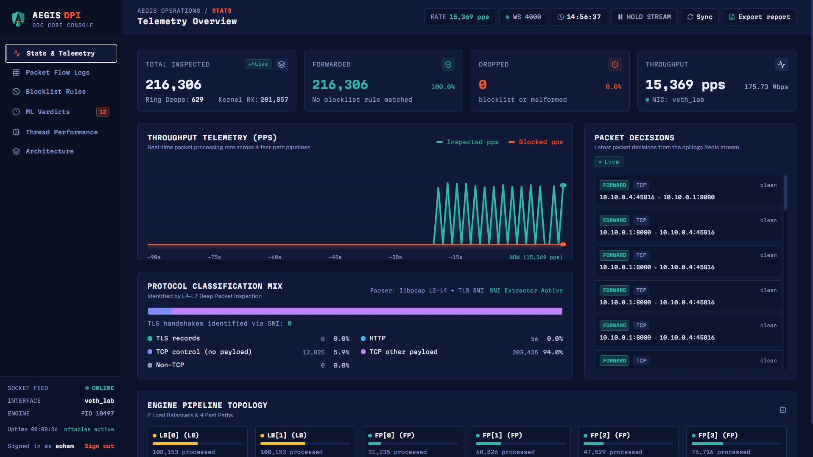
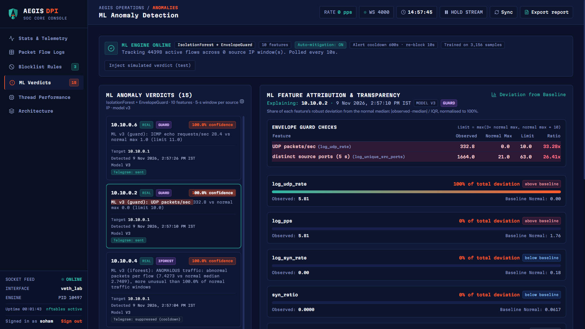
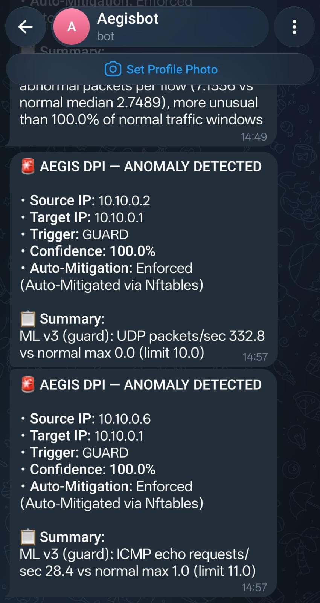
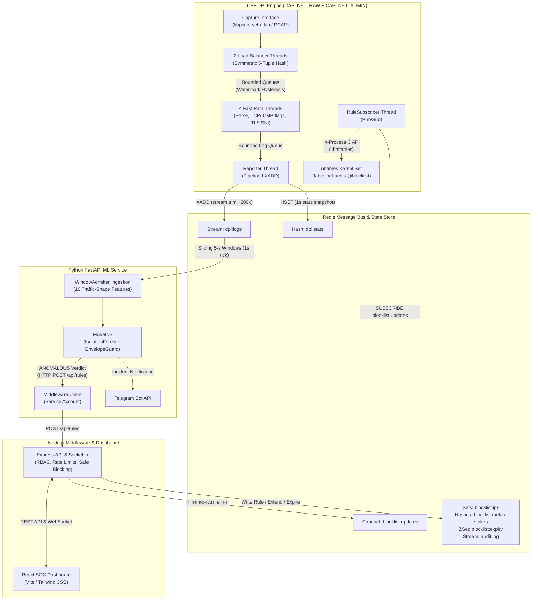

# AegisDPI

Final-year research project — B.Sc. Computer Science, Bhavan's College, Mumbai (2026). Project guide: Ms. Krupa Kamdar.

A multi-threaded C++ deep packet inspection engine with kernel-level blocking (nftables), an ML anomaly detector, and a SOC-style dashboard.

[](https://github.com/soham-88/AegisDPI/actions/workflows/ci.yml)


| Real-time SOC Dashboard & Telemetry | ML Anomaly Verdict & Envelope Guard Breakdown |
| :---: | :---: |
| <br><sub>Live packet inspection rate, system throughput, and protocol distribution.</sub> | <br><sub>IsolationForest anomaly index and per-feature envelope guard ratio table.</sub> |
| **Kernel Blocklist & Append-Only Audit Trail** | **External Incident Alert Dispatch (Telegram)** |
| <br><sub>Active nftables block rules, automated TTL expiry, and audit log.</sub> | <br><sub>Real-time out-of-band alert notification with attack attribution.</sub> |

---

## Highlights

- **Replay Throughput**: Bounded queue optimizations (watermark hysteresis, batch popping, and non-blocking polling) raised 1 Fast Path (FP) replay throughput from 53,194 PPS to 389,869 PPS (7.3x improvement) and 4-FP throughput from 253,029 PPS to 831,974 PPS (3.3x improvement) with 0 reporter drops (replay mode, 2,002,000 packets, Redis disabled (reporter output not sent), WSL2, Release build).
- **Context-Switch Reduction**: Lock-amortized batch operations (`pushBatch` / `popBatch` up to 256 packets) and low-watermark hysteresis (`max_size_ / 2`) reduced 1-FP voluntary context switches by 99.7% from 4,355,986 (41.98 s system time) to 13,818 (0.32 s system time).
- **Live Capture Zero-Drop**: Inspected live network traffic on `veth_lab` at 50,000 PPS, 100,000 PPS, 200,000 PPS, 400,000 PPS, and up to 413,904.42 PPS with 0 kernel packet drops (0.00% to 0.21% capture loss; note: ~414K PPS is the maximum transmission rate achieved by `tcpreplay` over virtual ethernet on WSL2, serving as a lower bound for the engine).
- **Pipelined Telemetry Ingestion**: Pipelined Redis `XADD` streaming with stream trimming (`DPI_LOGS_MAXLEN ~ 200000`) increased delivered log events from 25,360 to 285,968 events at 4 FPs (an increase of about 11x) during 2,002,000 packet replays with 0 Redis failures.
- **Held-Out ML Detection (v3)**: On the held-out evaluation dataset `mixed-test-2` (recorded after v3 was frozen), the hybrid v3 detector blocked 6 of 7 attack types at the `ANOMALOUS` threshold and detected all 7 at $\ge \text{SUSPICIOUS}$, achieving 1.000 precision, 0.000 false positive rate (FPR), 0.772 recall (up from 0.603 in v1), 0.871 F1 score (up from 0.753 in v1), 0.996 ROC-AUC, and 0.989 PR-AUC.
- **Legitimate Heavy User Protection**: False blocks of a legitimate high-throughput downloader fell from 5 episodes (v1, 32.1/h) to 1 episode (v3, 6.4/h) over 443 scored ticks on the development dataset (`mixed-test`), and from 4 episodes (v1, 16.0/h) to 0 episodes (v3, 0.0/h) over 729 scored ticks on `benign-val`.
- **Least-Privilege Engine (No Root / No Sudo)**: The engine binary runs as an unprivileged user using Linux file capabilities (`CAP_NET_RAW` and `CAP_NET_ADMIN`) on a root-owned `/usr/local/sbin/aegis-dpi-engine` binary (`0755`), utilizing in-process `libnftables` (zero shell invocation); redis++ linked statically, no RPATH/RUNPATH; the remaining shared libraries come from /usr/lib.
- **Automated CI & Vulnerability Gates**: GitHub Actions CI workflow runs unit tests, binary security verification, replay integration smoke tests, Node.js test suites, TypeScript compilation, production build, ShellCheck, and Gitleaks secret scanning across 6 independent jobs on Ubuntu 24.04.

---

## Architecture



### End-to-End Pipeline Flow
1. **Packet Ingestion & Load Balancing**: The capture subsystem ingests raw frames via `libpcap` into 2 Load Balancer (LB) threads. LBs compute a symmetric 5-tuple hash and distribute packets across 4 Fast Path (FP) worker queues using watermark hysteresis.
2. **Metadata Extraction & Classification**: FP workers parse Ethernet, IPv4, TCP, UDP, and ICMP headers, extract TLS Server Name Indication (SNI), record packet decisions, and enqueue log records into a dedicated bounded queue.
3. **Pipelined Telemetry Ingestion**: The Reporter thread aggregates log entries and executes non-blocking pipelined `XADD` writes into the Redis stream `dpi:logs`, periodically trimmed to `DPI_LOGS_MAXLEN` (~200,000 entries).
4. **Sliding-Window ML Evaluation**: The ML service consumes `dpi:logs`, builds 10 traffic-shape features over a sliding 5-second window per source IP, and scores them every second using the hybrid v3 model (IsolationForest + EnvelopeGuard).
5. **Automated Mitigation & Audit**: Upon an `ANOMALOUS` verdict, the ML service invokes `POST /api/rules` on the Node.js middleware. The middleware validates IP and allowlist constraints, calculates the escalating TTL, records the action in `audit:log`, updates Redis block sets, and publishes an update event to `blocklist:updates`.
6. **Kernel-Level Dropping**: The engine's `RuleSubscriber` thread receives the update and applies the block directly into the kernel's `table inet aegis @blocklist` via the in-process `libnftables` C API. Subsequent packets from the offending IP drop immediately in the network stack.

---

## How It Works

### Engine Architecture
The engine is structured as a multi-threaded pipeline designed to minimize cache thrashing, lock contention, and kernel context switching:
- **Thread Topology**: 2 Load Balancers read raw frames and partition traffic across 4 Fast Path workers using a symmetric 5-tuple flow hash ($H(\text{src}, \text{dst}, \text{sport}, \text{dport}) = H(\text{dst}, \text{src}, \text{dport}, \text{sport})$): both directions of a flow go to the same Fast Path.
- **Queue Hysteresis & Batching**: Queues implement low-watermark hysteresis (`low_watermark_ = max_size_ / 2`) and lock-amortized batch operations (`pushBatch` and `popBatch` up to 256 packets), preventing producer-consumer ping-pong.
- **Non-Blocking Telemetry Reporting**: The Reporter thread polls its log queue with zero timeout, sleeping 2 ms only when fewer than 512 events are pending. Writes to Redis stream `dpi:logs` are submitted via pipelined multi-command buffers, achieving up to 746,800 delivered events with 0 Redis failures.

### ML Anomaly Detector Evolution
- **v1 (Volume Baseline)**: Evaluated 5 volume features (packets_per_second, unique_dst_ports, unique_dst_ips, dropped_ratio, protocol_diversity) using an IsolationForest trained on 1,000 synthetic vectors with a manual "$> 4\times\text{ baseline}$" rule. Offline evaluation revealed that normal heavy downloads (~350 pps ACKs) were flagged as anomalies in every burst, while low-rate ICMP attacks went undetected.
- **v2 (Traffic-Shape Features)**: Replaced volume features with 10 traffic-shape metrics (packet rate, SYN rate, SYN ratio, RST rate, ICMP echo rate, UDP rate, unique destination ports, unique source ports, packets per flow, unique destination IPs) trained on 30 minutes of real benign traffic (`benign-train`). While false blocks of heavy downloaders dropped significantly, v2 missed UDP floods (median score 0.140 vs threshold 0.186) and low-rate ICMP floods (0.185 vs 0.186). Because `log_udp_rate` and `log_rst_rate` were constant zero in training data, the IsolationForest could not construct split criteria on them and failed to extrapolate.
- **v3 (IsolationForest + Envelope Guard)**: Retains the v2 IsolationForest unchanged and pairs it with a learned per-feature envelope guard across 6 shape features. For each feature, an upper bound limit is established:
  $$\text{limit} = \max(3 \times \text{normal\_max},\, \text{normal\_max} + 10)$$
  A verdict is `ANOMALOUS` if the base IsolationForest scores above the calibration threshold or if any shape feature exceeds its envelope guard limit ($\text{ratio} > 1.0$). Evaluated on held-out data, v3 restored detection of UDP and ICMP floods while maintaining 0 false positives.

### Safe Blocking Policy
To prevent permanent lockouts, denial-of-service against administrative services, or self-inflicted outages:
- **Automated TTL Escalation Ladder**: Blocks created by the ML service enforce an escalating duration based on strikes within a rolling 24-hour window (`ML_STRIKE_WINDOW_S = 86400` s):
  - Strike 1: 600 seconds (10 minutes)
  - Strike 2: 3,600 seconds (1 hour)
  - Strike 3+: 86,400 seconds (24 hours)
- **Manual Block Durations**: Administrative users may set arbitrary TTL durations between 60 s and 2,592,000 s (30 days), or select permanent enforcement.
- **CIDR-Aware Allowlisting**: Subnets and individual IPs (`/0` through `/32`) stored in `allowlist:entries` reject block attempts with HTTP 409 Conflict (`block_rejected`). Adding an allowlist entry immediately evicts any matching address from the active blocklist.
- **Append-Only Audit Stream**: All state mutations (`block`, `extend`, `unblock`, `expire`, `block_rejected`, `allowlist_*`) are committed to Redis stream `audit:log` (capped at ~10,000 entries) and displayed in the management console.
- **Autonomous Sweeper**: A background sweeper evaluates expired entries every 5,000 ms using sorted-set range queries (`ZRANGEBYSCORE blocklist:expiry -inf <now>`), pruning stale kernel rules.

### Security Architecture & Hardening Controls
- **Zero Sudo Execution**: The engine does not execute under `sudo`. It operates as a regular unprivileged user utilizing Linux file capabilities (`CAP_NET_RAW` and `CAP_NET_ADMIN`) set on `/usr/local/sbin/aegis-dpi-engine` (`0755`, owned by `root:root`).
- **In-Process Kernel Enforcement**: All firewall modifications use `libnftables` C API (`nft_ctx_new`, `nft_run_cmd_from_buffer`), eliminating shell spawning (`/bin/sh`) and command injection risks.
- **Binary Hardening**: Built with static `redis++_static` and `SKIP_BUILD_RPATH TRUE` (redis++ linked statically, no RPATH/RUNPATH; the remaining shared libraries come from /usr/lib). `readelf -d` verifies zero embedded `RPATH` or `RUNPATH` tags, preventing shared library hijacking.
- **Role-Based Access Control**: JWT authentication separates `admin` operators (full access, WebSocket telemetry) from `ml-service` (restricted strictly to `POST /api/rules`). Socket.io rejects non-admin handshakes.
- **Input Validation & Anti-Spoofing**: Strict IPv4 dotted-quad verification rejects malformed strings and leading-zero octals. `TRUST_PROXY=false` resolves client IPs strictly from `req.socket.remoteAddress`, neutralizing `X-Forwarded-For` rate-limit bypasses.
- **Security Headers & CSP**: Universal security headers (`nosniff`, `DENY`, `no-referrer`) and strict Content Security Policy (`default-src 'self'`) protect the web console from framing and injection attacks.
- **Startup Integrity Checks**: The middleware refuses to start if `JWT_SECRET` is missing, shorter than 32 characters or equal to the example placeholder, or if `REDIS_URL` has no password; the ML service refuses to start without `REDIS_URL`.

---

## Results

### 1. Engine Performance Benchmarks

#### Replay Throughput Optimization (replay mode, 2,002,000 packets, Redis disabled (reporter output not sent), WSL2, Release build)
| Worker Threads (FPs) | Baseline PPS | Baseline Reporter Drops | Hysteresis+Batch PPS | Final Batching+Poll PPS | Final Reporter Drops | Voluntary Context Switches |
|---|---|---|---|---|---|---|
| 1 FP | 53,194 | 0 | 176,403 | 389,869 | 0 | 13,818 (from 4,355,986) |
| 2 FP | 71,031 | 0 | 135,936 | 596,393 | 0 | 38,290 |
| 4 FP | 253,029 | 0 | 1,061,298 | 831,974 | 0 | n/m |
| 8 FP | 758,172 | 827,574 | 1,108,575 | 796,339 | 0 | 221,400 (from 579,926) |

* Voluntary context switches were measured with `/usr/bin/time -v` for 1, 2 and 8 FPs only.
* Final 4-FP and 8-FP throughput achieved zero reporter drops across the entire 2.0M packet replay run, compared to earlier optimization passes that dropped up to 65% of telemetry.

#### Live Capture Benchmark (`veth_lab`, 4 FP threads, 300,000 packets per target rate)
| Target Rate (PPS) | Sent Packets | Achieved PPS | Processed Packets | Kernel Packet Drops | Capture Loss % | Log Delivery % |
|---|---|---|---|---|---|---|
| 50,000 | 300,000 | 50,000.16 | 300,000 | 0 | 0.00% | 100.00% |
| 100,000 | 300,000 | 100,000.33 | 299,992 | 0 | 0.00% | 100.00% |
| 200,000 | 300,000 | 200,000.66 | 299,984 | 0 | 0.01% | 100.00% |
| 400,000 | 300,000 | 400,001.06 | 300,000 | 0 | 0.00% | 75.30% |
| topspeed | 300,000 | 413,904.42 | 299,378 | 0 | 0.21% | 73.68% |

*Note: ~414K PPS is the maximum transmission rate achieved by `tcpreplay` over virtual ethernet on WSL2, serving as a lower bound for engine capture capability.*

Full methodology and benchmark profiling available in [bench/RESULTS.md](bench/RESULTS.md).

---

### 2. ML Anomaly Detection Performance

#### Held-Out Evaluation (`mixed-test-2`, 907,479 events, seed 2026, frozen v3 commit `583e313`)
| Model | Threshold Level | Precision | Recall | F1 Score | FPR | ROC-AUC | PR-AUC | Attacks Detected |
|---|---|---|---|---|---|---|---|---|
| **v1 (Volume Baseline)** | ANOMALOUS | 1.000 | 0.603 | 0.753 | 0.000 | 0.971 | 0.919 | 5 of 7 |
| **v1 (Volume Baseline)** | $\ge\text{SUSPICIOUS}$ | 0.704 | 0.841 | 0.766 | 0.085 | 0.971 | 0.919 | 7 of 7 |
| **v2 (Traffic-Shape)** | ANOMALOUS | 1.000 | 0.466 | 0.635 | 0.000 | 0.994 | 0.980 | 4 of 7 |
| **v2 (Traffic-Shape)** | $\ge\text{SUSPICIOUS}$ | 0.974 | 0.797 | 0.877 | 0.005 | 0.994 | 0.980 | 6 of 7 |
| **v3 (Hybrid Guard)** | ANOMALOUS | 1.000 | 0.772 | 0.871 | 0.000 | 0.996 | 0.989 | **6 of 7** |
| **v3 (Hybrid Guard)** | $\ge\text{SUSPICIOUS}$ | 0.978 | 0.953 | 0.965 | 0.005 | 0.996 | 0.989 | **7 of 7** |

#### Detection Latency by Attack Type (Seconds from first admitted packet to ANOMALOUS verdict)
| Attack Type | Tool / Profile | v1 Latency | v2 Latency | v3 Latency | Verdict (v3) |
|---|---|---|---|---|---|
| `icmp_flood_high` | `hping3 --icmp -i u200` | 0.9s | 0.9s | 0.9s | Blocked (`ANOMALOUS`) |
| `syn_flood_high` | `hping3 -S -p 8080 -i u200` | 0.7s | 0.7s | 0.7s | Blocked (`ANOMALOUS`) |
| `udp_flood_high` | `hping3 --udp -p 9999 -i u200` | 0.6s | Missed | 0.6s | Blocked (`ANOMALOUS` via Guard) |
| `port_scan_fast` | `nmap -sS -Pn -T4 -p 1-5000` | 5.3s | 5.3s | 5.3s | Blocked (`ANOMALOUS`) |
| `syn_flood_low` | `hping3 -S -p 8080 -i u5000` | 2.6s | 0.6s | 0.6s | Blocked (`ANOMALOUS`) |
| `icmp_flood_low` | `hping3 --icmp -i u10000` | Missed | Missed | 1.4s | Blocked (`ANOMALOUS` via Guard) |
| `port_scan_slow` | `nmap -sS -Pn -T2 -p 1-100` | Missed | Missed | Missed | Flagged (`SUSPICIOUS` only) |

* Port-scan latency is measured from the scanner's first admitted packet, which for nmap includes its DNS lookup before scanning starts.

Full evaluation metrics, confusion matrices, and reproduction scripts available in [eval/RESULTS.md](eval/RESULTS.md).

---

## Quick Start

### 1. Prerequisites
Developed and tested on Ubuntu 26.04 under WSL2; CI builds and tests on Ubuntu 24.04:
```bash
sudo apt-get update && sudo apt-get install -y \
  build-essential cmake g++ libpcap-dev libhiredis-dev libnftables-dev \
  redis-server python3-venv nodejs npm ethtool hping3 nmap tcpreplay tcpdump
```

### 2. Setup & Environment Initialization
Clone the repository and run the automated setup script:
```bash
git clone https://github.com/soham-88/AegisDPI.git
cd AegisDPI

./scripts/setup.sh
```
`./scripts/setup.sh` automatically compiles the engine, builds the frontend bundle, creates the Python virtual environment, configures environment files, and runs `./scripts/install_engine.sh` to install the engine binary into `/usr/local/sbin/aegis-dpi-engine` with Linux file capabilities (`CAP_NET_RAW` and `CAP_NET_ADMIN`). It prompts interactively for the administrator username (default: `admin`) and password ($\ge 10$ characters), hashing the password with bcrypt and writing credentials to `middleware/.env`.

*(Note: `./scripts/install_engine.sh --remove-sudoers` is only needed when upgrading from an older sudoers-based installation.)*

### 3. Start Network Lab & Core Services
```bash
# Create isolated namespace ns_attacker, host interface veth_lab, and disable offloads (prompts for sudo internally)
./scripts/lab.sh up

# Start Redis (6379), ML Service (8000), and Middleware/Frontend (4000)
./scripts/aegis.sh start
```

### 4. Access Console & Start Capture
1. Open your browser at **`http://127.0.0.1:4000`**.
2. Sign in with the administrator credentials configured during `setup.sh` (default user: `admin`).
3. Click **Start Capture** on interface `veth_lab`.

### 5. Run Test Flood & Verify Mitigation
Execute an attack flood from the isolated namespace:
```bash
# Run high-rate ICMP flood from ns_attacker (10.10.0.2)
sudo ip netns exec ns_attacker hping3 --icmp -i u1000 -I veth_attacker -a 10.10.0.2 10.10.0.1
```
- Within $\sim 1$ second, the ML service flags the anomalous traffic and enforces an automated block.
- Subsequent packets are dropped in-kernel via `nftables` (100% loss).
- Audit trail, active block rules, and feature attributions update live on the dashboard.

To stop services and tear down the lab:
```bash
./scripts/aegis.sh stop
./scripts/lab.sh down
```

---

## Repository Layout

```text
├── .github/          # GitHub Actions CI workflow (ci.yml) and Dependabot configuration
├── bench/            # Engine replay/live benchmarks, raw CSV results, and performance reports
├── datasets/         # Benign baseline and attack evaluation schedules and recording tools
├── docs/             # Technical specifications, threat models, hardening designs, and guides
├── engine/           # Multi-threaded C++17 DPI capture engine, parsers, and in-process enforcer
├── eval/             # Offline ML evaluation harness, scoring comparisons, and validation results
├── frontend/         # React, TypeScript, and Tailwind CSS SOC operations dashboard
├── middleware/       # Node.js Express API server, Socket.io gateway, RBAC, and audit logger
├── ml-service/       # Python FastAPI real-time anomaly detection service (IsolationForest + Guard)
└── scripts/          # Lifecycle automation, capability installation, and lab topology scripts
```

---

## Testing

### CI Automation
Every push and pull request to `main` executes 6 independent jobs on `ubuntu-24.04`:
1. **`engine`**: Compiles C++ engine in `Release` mode, runs GoogleTest suite `dpi_tests`, verifies zero `RPATH`/`RUNPATH` tags, checks library resolution, and validates integration replay output.
2. **`middleware`**: Sets up Node 22, executes `npm ci`, runs 26 unit and integration tests via `node:test`, and runs `npm audit --omit=dev --audit-level=high`.
3. **`frontend`**: Sets up Node 22, runs `npm ci`, validates TypeScript types (`npx tsc --noEmit`), compiles production Vite bundle, and audits production dependencies.
4. **`ml-service`**: Sets up Python 3.14, installs pinned dependencies, executes 16 unit tests via `unittest`, and audits Python packages with `pip-audit`.
5. **`scripts`**: Executes `shellcheck -S error` across all repository shell scripts.
6. **`secrets`**: Runs `gitleaks-action` across full repository git history against allowlisted templates.

### Running Tests Locally
```bash
# 1. Engine unit tests (18 tests)
engine/build/dpi_tests

# 2. Middleware test suite (26 tests)
(cd middleware && npm test)

# 3. ML Service unit tests (16 tests)
(cd ml-service && venv/bin/python -m unittest discover -s tests -v)

# 4. ML service status & live inference smoke test
./scripts/ml_smoke.sh

# 5. Safe blocking, role authorization, and audit trail test
./scripts/phase4_smoke.sh

# 6. Replay throughput benchmark
./scripts/bench.sh

# 7. Live capture benchmark
./scripts/bench_live.sh

# 8. Offline ML evaluation harness
(cd ml-service && venv/bin/python evaluate_offline.py --dataset ../datasets/mixed-test-2 --model v3 --label v3-hybrid --local-ips 10.10.0.1,10.255.255.254)
```

---

## Limitations

- **Per-Packet Telemetry Bound**: Per-packet logging saturates Redis stream ingestion around $\sim 300,000$ events/second; extreme packet rates require flow-level summarization.
- **Virtualized Environment**: Performance evaluations were conducted in a virtualized WSL2 guest over virtual ethernet interfaces (`veth`) rather than dedicated physical 10GbE/100GbE network interfaces.
- **Fixed Attack Suite**: Test datasets evaluate 7 synthetic attack types; generalization across unseen application protocols and zero-day attack classes is unverified.
- **Cadence & Window Trade-Off**: The 1-second evaluation tick over 5-second sliding windows detects fast scans within 5.3s, but cannot preemptively drop sub-second micro-burst scans before completion.
- **Slow Port Scan Boundary**: Low-rate stealth port scans ($\sim 2$ ports/second) are detected only at the `SUSPICIOUS` threshold because their port count falls just below the 13-port envelope guard limit over a 5-second window.
- **IPv4 Exclusive**: Packet parsing, flow hashing, ML schemas, and `libnftables` rule generation support IPv4 only; IPv6 headers and neighbor discovery are unhandled.

---

## Future Work

- **Flow-Level Telemetry Aggregation**: Transition from per-packet streaming to flow-level records (NetFlow/IPFIX format) to remove the per-packet logging ceiling.
- **Multi-Scale Sliding Windows**: Add secondary sliding windows (30 s and 300 s) to accurately flag slow stealth port scans and low-and-slow DoS attacks at the `ANOMALOUS` threshold.
- **Zero-Copy In-Path Inline Blocking**: Integrate Linux NFQUEUE or eBPF/XDP hooks to inspect and drop malicious packets inline before network delivery.
- **TLS Client Fingerprinting**: Implement JA3/JA4 fingerprint hashing from ClientHello payloads to identify malicious client software regardless of IP rotation.
- **Threat Intelligence Feed Ingestion**: Synchronize malicious IP and domain blocklists directly into Redis and nftables sets.
- **IPv6 Dual-Stack Support**: Extend parser structures, symmetric 5-tuple hashing, and nftables rules to support native IPv6 inspection.

---

The packet-parsing code is based on perryvegehan/Packet_analyzer (https://github.com/perryvegehan/Packet_analyzer); everything else was built for this project. Thanks to Ms. Krupa Kamdar for guiding the project.
